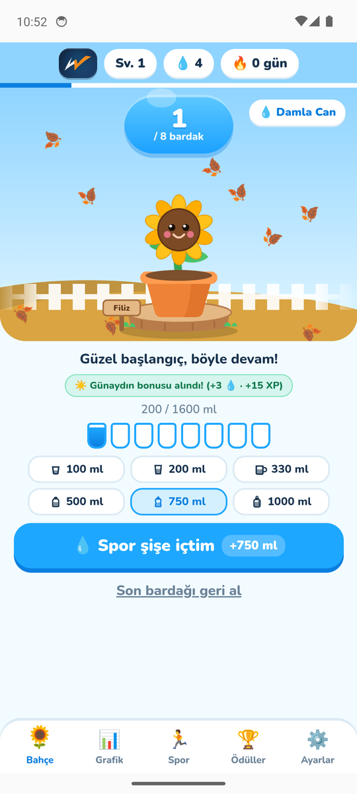
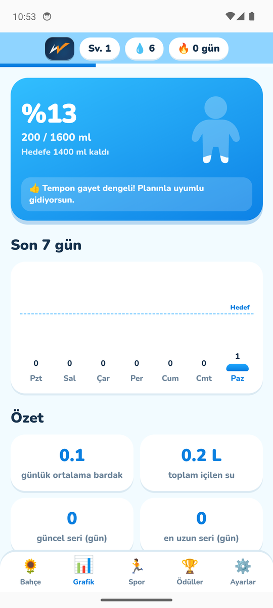
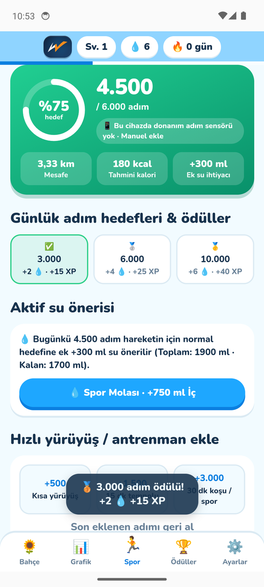
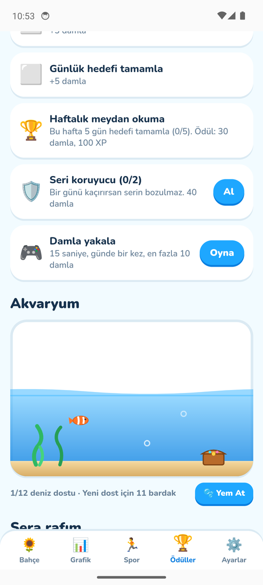

<p align="center">
  
</p>

<h1 align="center">Yudum 💧</h1>

<p align="center">
  <b>Günlük su içme alışkanlığını oyunlaştıran Android (Capacitor 8) ve PWA uygulaması</b><br/>
  Bahçe &amp; akvaryum büyütme · Sabah ilk yudum bonusu · Donanım adım sayar (Spor sekmesi)
</p>

<p align="center">
  
  
  
</p>

---

## 📥 İndir ve Telefona Kur (Android APK)

1. Sağdaki **[Releases (Sürümler)](https://github.com/ubeydsahin/yudum-/releases)** sayfasına girin ve son sürüm altındaki **`Yudum-v1.1.apk`** dosyasını indirin.
2. İndirilen `.apk` dosyasına dokunun (Android isterse *"Bu kaynaktan uygulamalara izin ver"* seçeneğini onaylayın) ve kurulumu tamamlayın.
3. **Adım Sayar (🏃 Spor sekmesi):** Fiziksel aktivite iznini onayladığınızda telefonunuzun donanım adım sensörü üzerinden günlük adımlarınızı takip eder.

---

## 📱 Uygulama Arayüzü

<table>
  <tr>
    <td align="center"><b>🌻 Bahçe &amp; Şişeler</b></td>
    <td align="center"><b>📊 Grafik &amp; Tempo</b></td>
    <td align="center"><b>🏃 Spor &amp; Adım Sayar</b></td>
    <td align="center"><b>🐠 Ödüller &amp; Akvaryum</b></td>
  </tr>
  <tr>
    <td></td>
    <td></td>
    <td></td>
    <td></td>
  </tr>
</table>

---

## ✨ Öne Çıkan Özellikler

- **Akıllı Su Takibi & Şişe Seçenekleri:** `100 ml`, `200 ml`, `330 ml`, `500 ml`, `750 ml` ve `1000 ml` hızlı içim seçenekleri ile özel hedef belirleme.
- **☀️ Sabah İlk Yudum Bonusu:** `05:00 – 10:59` saatleri arasında içilen ilk bardakta ekstra `+3 💧` damla ve `+15 XP` teşvik ödülü.
- **🌱 Bahçe, Saksı & Hayvan Dostlar:** Su içtikçe bitkilerin filizlenip çiçek açar; kazandığın damlalarla yeni bitkiler, saksılar ve dostlar açarsın.
- **🐠 Etkileşimli Akvaryum & Besleme Mekaniği:**
  - Su içtikçe `12` farklı deniz dostuna kadar akvaryumunu doldurursun.
  - Yem attığında balıklar yeme doğru dönüp yüzerek yemleri yakalar.
  - Başlangıçta zayıf ve hızlı yüzen balıklar yem yedikçe **kademe kademe kilo alır**; en sonunda **balon gibi şişip yavaşlar ve artık yem yiyemez** (`Zayıf → Normal → Tombul → Şişman → Balon`).
- **🏃 Spor & Donanım Adım Sayar:**
  - Android donanım adım sensörü (`StepCounter` Capacitor eklentisi — `TYPE_STEP_COUNTER` birincil ve `TYPE_STEP_DETECTOR` yedek) ile adım takibi + hızlı antrenman ekleme.
  - Günlük `3.000 / 6.000 / 10.000` adım ödülleri, mesafe (`km`), kalori (`kcal`) ve atılan adıma göre dinamik ek su önerisi.
- **📊 İstatistik, Rozet & Yedekleme:** 7 günlük su/adım grafikleri, başarım rozetleri, JSON yedekleme/geri yükleme ve yerel bildirim hatırlatıcıları.

---

## 👨‍💻 Geliştirici ve Teknik Bilgiler

- **Geliştirici:** Said Ubeydullah ŞAHİN
- **Paket Kimliği:** `com.saidubeydullahsahin.yudum`
- **Minimum / Hedef Android:** Android 7.0+ (`minSdkVersion 24`, `targetSdkVersion 36`)
- **Teknolojiler:** HTML/CSS/JS (ES2019 uyumlu WebView + PWA Service Worker), Capacitor 8, Android Java (`StepCounterPlugin`)

---

## 🛠️ Kaynak Koddan Derleme (Geliştiriciler İçin)

### Gereksinimler

- Node.js (npm)
- JDK 21+ (`JAVA_HOME`)
- Android SDK (`ANDROID_HOME`)

### Kurulum ve Senkronizasyon

```bash
npm install
npm run cap:sync
```

### APK Üretimi

İmzalı Release APK derlemek için proje köküne (`.gitignore` tarafından hariç tutulan) bir `keystore.properties` dosyası ve `.jks` anahtar deposu ekleyin:

```properties
storeFile=yudum-release.jks
storePassword=SIFRENIZ
keyAlias=yudum
keyPassword=SIFRENIZ
```

Ardından derleme komutunu çalıştırın:

```bash
# Debug APK
npm run apk:debug

# İmzalı Release APK (Yudum-v1.1.apk)
npm run apk:release
```

---

## 📄 Lisans

Bu proje [MIT](https://opensource.org/licenses/MIT) lisansı ile sunulmaktadır.
